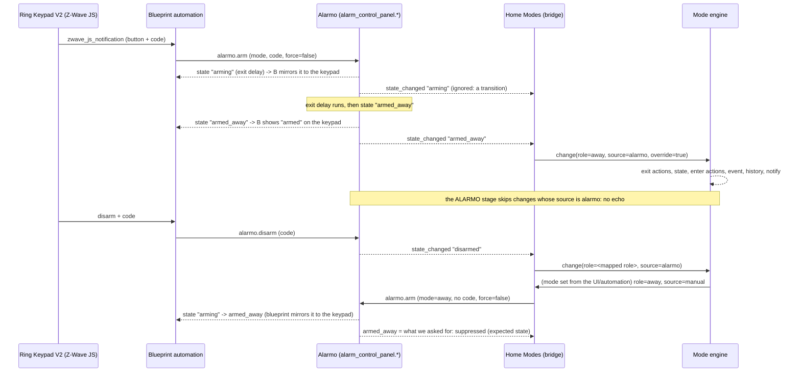

# Alarmo bridge and the Ring Keypad V2 Advanced blueprint

The bridge is **optional and off by default**. Home Modes never imports Alarmo; it only reads
the state of Alarmo's alarm entity and calls Alarmo's own services (`alarmo.arm`,
`alarmo.disarm`). It sets up and works normally when Alarmo is not installed, and keeps working
(with one reported bridge error) if Alarmo is removed later.

Versions checked: Alarmo 1.10.19 (`nielsfaber/alarmo`) and the Ring Keypad V2 Advanced
blueprint (`Ryckie/Ring-Keypad-V2-Advanced-Blueprint`), read from source. The blueprint is
**not changed or required**: it only talks to Alarmo, and so does the bridge.

## How a keypad press flows

Details from the source:

- The blueprint triggers on Z-Wave JS notification events from the keypad and calls
  `alarmo.arm` (mode from its home/away mapping, `force: false`, the code typed on the keypad;
  on an open-sensor failure it waits for `alarmo_failed_to_arm` and may re-arm with
  `force: true`) or `alarmo.disarm`. It mirrors every Alarmo state (`disarmed`, `arming`,
  `pending`, `armed_*`, `triggered`) back to the keypad and mobile notifications.
- A keypad press therefore reaches Home Modes **only as an Alarmo state change**. That is the
  single plug-in point; the bridge needs nothing from the blueprint.
- The bridge reacts only to *final* states (`disarmed`, `armed_home`, `armed_away`,
  `armed_night`, `armed_vacation`, `armed_custom_bypass`). `arming`, `pending` and
  `triggered` are transitions and never change the mode.
- Alarmo's `context_id` service field is an internal integer, not a Home Assistant `Context`.
  Home Assistant keeps the caller's `Context` on an entity state write only for a few seconds,
  so an instant arm keeps it, but the final `armed_*` state after an exit delay does not.

## Settings

Configure → More → Alarmo bridge.

| Setting | Default | Meaning |
| --- | --- | --- |
| Enable the bridge | off | Nothing is registered while it is off |
| Direction | both | `both`, `to_alarmo` (Home Modes → Alarmo) or `from_alarmo` |
| Alarmo entity | auto | Leave empty to use the only Alarmo alarm panel |
| Apply automatic mode changes to Alarmo | **off** | See *Safety* |
| Mapping table | empty | One row per Alarmo state (below) |

Each row (`disarmed`, `armed_home`, `armed_away`, `armed_night`, `armed_vacation`,
`armed_custom_bypass`) has a **mode** (a primary mode, including custom modes), and two
independent switches: *mode change sets this Alarmo state* (`to_alarmo`) and *Alarmo state sets
this mode* (`from_alarmo`). A row with both off is disabled. A mode can be used by one
`to_alarmo` row only. The `disarmed` row has a third switch, *Allow disarming Alarmo*.

### Alarmo → Home Modes

An Alarmo state change becomes a mode change with source `alarmo` (rank 1, same as manual).
It starts an override according to the override settings (*Manual override*). With the
default *Next auto-rule trigger*, the next automatic trigger (for example everybody leaving)
ends that override and applies; choose *After a duration*, *End of day* or *Until set_auto*
if a keypad change should hold longer. Attribute-only updates
are ignored.

### Home Modes → Alarmo

A mode change calls `alarmo.arm` with the mapped mode, `skip_delay: false` and `force: false`,
so Alarmo's own exit delay and open-sensor checks apply. If Alarmo refuses (open sensors, event
`alarmo_failed_to_arm`) the mode is **not** reverted; a bridge error is recorded and, if you
have a rule, notified.

## Codes

**No alarm code is ever stored**, in the options or anywhere else. The bridge never sends a
code. If Alarmo reports that a code is required for the action, the bridge does nothing and
reports `code_required`. To use the Home Modes → Alarmo direction, turn off *require code to
arm* (and, for disarming, *require code to disarm*) in Alarmo. Arming without a code from a
trusted source is the same trade-off as any automation that arms Alarmo. UNVERIFIED: whether
Alarmo offers a secret-free per-caller bypass; none was found in the source.

## Safety

1. **Home Modes never disarms Alarmo by default.** A `to_alarmo` row for `disarmed` does
   nothing unless *Allow disarming Alarmo* is switched on for that row. The options screen and
   this page carry the warning: switching to that mode **disarms your alarm**.
2. Even with that switch on, a mode change made by an **allow-list (guest) user** never
   disarms (a guest who may select "Home" must not be able to disarm the house).
3. **Automatic changes** (schedule, sensors, presence, temporary-mode expiry) never arm or
   disarm Alarmo unless *Apply automatic mode changes to Alarmo* is on. Disarming still needs
   the per-row switch. `system` changes (startup reconcile) never reach Alarmo.
4. The bridge does not touch Alarmo while it is `arming`, `pending` or `triggered`
   (the history shows `alarm_busy`).
5. There is no sync at startup: nothing is armed or disarmed because Home Assistant restarted.

Other risks to be aware of:

- **Blueprint presence overlap.** The Ring blueprint has optional presence-based arming (arm
  Away when everyone leaves, disarm on arrival; off by default). Home Modes presence plus
  *Apply automatic mode changes to Alarmo* does the same job. Use one of them, not both.
- **Disarm on arrival** is risky on its own (a GPS glitch disarms the house). Prefer
  `to_alarmo` arming only.
- **Open sensors.** A mode can say "away" while Alarmo refused to arm. The mode and the alarm
  can disagree; watch the bridge errors.
- **Failed-attempt counters.** A rejected code attempt counts in Alarmo; the bridge sends no
  code so it cannot trigger them.
- **Alarmo "Disarm after triggering"** must stay off for the blueprint; unrelated to Home Modes.

## Loop guard

Three layers, tested for all three directions and for near-simultaneous changes:

1. **Origin tag.** Every change carries its source. A change with source `alarmo` is never sent
   back to Alarmo.
2. **Own context ids.** The bridge remembers the `Context` of its service calls. Alarmo state
   writes that carry it (instant transitions) are ignored.
3. **Expected state.** After asking for state X, the next final state X within 15 seconds is
   treated as our own echo. When Alarmo reports `arming` with a `delay`, the window is extended
   by that delay plus 10 seconds. A different final state ends the expectation and is handled
   as a real change (for example a keypad disarm during the exit delay). An
   `alarmo_failed_to_arm` event during the window ends it and is recorded.

Limits: a person who triggers *the same final state* as the one we requested during the window
is treated as an echo (the result is identical, so nothing is lost). If both sides change within
the same moment the last change wins; the bridge makes at most one request per Home Modes change
and never answers an Alarmo change, so the two cannot keep each other going.

## Known limitations

1. **The 15 s echo window.** After the bridge asks Alarmo for a state, the next final state with
   the same value inside the window (15 s, extended by Alarmo's exit delay plus 10 s while it is
   `arming`) is treated as our own echo. A person pressing the keypad for *the same* final state
   inside that window is ignored. The end result is the same mode, so nothing is lost, but no
   override is started by that keypad press.
2. **No code storage.** The bridge never stores or sends an alarm code. If Alarmo requires a code
   for the requested action (arming from Home Modes, or disarming), the bridge does nothing and
   only records `code_required` in the history (and notifies on a `bridge_error` rule). The
   mode still changes. Those setups need *require code* switched off in Alarmo for the
   Home Modes → Alarmo direction; the Alarmo → Home Modes direction is not affected.
3. **Overlap with the blueprint's optional presence arming.** The Ring blueprint can arm Away
   when everyone leaves and disarm on arrival (off by default). Home Modes presence plus
   *Apply automatic mode changes to Alarmo* does the same. Do not enable both: they would race
   each other and Alarmo would receive two commands.
4. **Open sensors.** If Alarmo refuses to arm (open sensors, `alarmo_failed_to_arm`), the
   Home Modes mode is **not** reverted: mode and alarm are then out of sync (for example mode
   *Away*, alarm *disarmed*) until someone fixes the sensor and changes the mode again or arms
   Alarmo. The bridge records `failed_to_arm` and can notify you.
5. **No startup sync.** After a restart nothing is armed or disarmed to match the mode.
6. **Same-moment changes.** If both sides change within the same moment, the last change wins and
   the two can briefly disagree; they never ping-pong (at most one request per Home Modes
   change, and Alarmo changes are never answered).
7. **One Alarmo entity.** With several Alarmo areas, pick the entity (usually the master); the
   bridge follows exactly one.
8. **Alarmo behaviour is read from source** (1.10.19), and checked once on a real
   Home Assistant 2026.11.1 with Alarmo.

## Without the blueprint

Nothing changes: any source that changes Alarmo (the Alarmo panel, an automation, the mobile
app) reaches Home Modes the same way.

## Blueprint findings

Nothing in the blueprint blocks a clean integration; **no blueprint change is proposed**.
